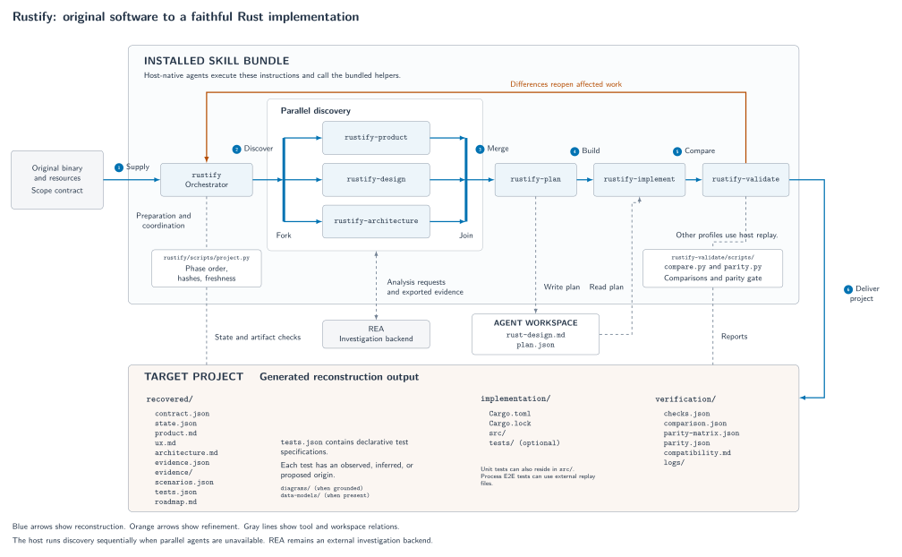

# Rustify architecture

Rustify contains eight skills, one shared standards guide, and four runtime Python helpers.
Host-native agents execute the installed instructions.
The installed skill bundle, temporary agent workspace, and generated target project have separate boundaries.



## Components and evidence

| Component | Responsibility | Evidence |
| --- | --- | --- |
| `rustify` | The orchestrator records the target, dispatches work, merges findings, and routes repairs. | `skills/rustify/SKILL.md` |
| `rustify-probe` | The skill captures behavior and binary evidence through REA throughout reconstruction. | `skills/rustify-probe/SKILL.md` |
| `rustify-product` | The skill recovers original behavior and EARS requirements. | `skills/rustify-product/SKILL.md` |
| `rustify-design` | The skill recovers interface behavior and design language. | `skills/rustify-design/SKILL.md` |
| `rustify-architecture` | The skill recovers original components, boundaries, and workflow traces. | `skills/rustify-architecture/SKILL.md` |
| `rustify-plan` | The skill writes the correspondences, slices, Rust design, and decision records. | `skills/rustify-plan/SKILL.md` |
| `rustify-implement` | The skill implements one slice at a time and records executed Rust checks. | `skills/rustify-implement/SKILL.md` |
| `rustify-validate` | The skill compares behavior and reports measured compatibility. | `skills/rustify-validate/SKILL.md` |
| `project.py` | The helper checks phase order, target identity, ledger sections, the slice plan, and freshness, and runs the Rust checks. | `skills/rustify/scripts/project.py` |
| `compare.py` | The helper captures and compares deterministic CLI runs. | `skills/rustify-probe/scripts/compare.py` |
| `parity.py` | The helper derives requirement results from the ledger, evidence, and captures, and runs the reflexion check. | `skills/rustify-validate/scripts/parity.py` |
| `fuzz.py` | The helper searches for inputs that make the original and the Rust implementation differ. | `skills/rustify-probe/scripts/fuzz.py` |
| Standards guide | The guide sets the writing rules, glossary, EARS form, and architecture viewpoints. | `skills/rustify/references/standards.md` |
| REA | The external backend supplies binary and runtime evidence through the probe skill. | `skills/rustify-probe/references/rea.md` |
| Target project | The directory contains recovered/, implementation/, and verification/. | `skills/rustify/references/project.md` |

## Flow and boundaries

1. The original binary and resources enter `rustify`.
2. The orchestrator invokes the probe skill for original captures and focused binary evidence.
3. The orchestrator dispatches the three discovery skills in parallel when the host supports agents.
4. The orchestrator merges their shards into the ledger and resolves contradictions.
5. The plan skill writes correspondences, a walking skeleton, risk-ordered slices, the design, and ADRs.
6. The implementation and validation skills run once for each slice.
7. Validation differences reopen the affected discovery, planning, or implementation work.

The host runs discovery sequentially when parallel agents are unavailable.
Workers write shards in the agent workspace and coordinate access to shared REA sessions.
Discovery, planning, implementation, and validation request captures and traces from the probe skill.
The probe skill exports REA evidence into the target project.
The validator also requests independent challenges after the freeze.
REA remains an external investigation backend.

The target project has three folders.

| Folder | Contents |
| --- | --- |
| `recovered/` | `state.yaml`, `model.yaml`, `product.md`, `ux.md`, `architecture.md`, `evidence.yaml`, `evidence/`, `scenarios.yaml`, `tests.yaml`, and `roadmap.md`. |
| `implementation/` | `Cargo.toml`, `Cargo.lock`, `src/`, `tests/`, `docs/design.md`, and `docs/adr/`. |
| `verification/` | `checks.yaml`, `comparison.yaml`, `fuzz.yaml`, `parity.yaml`, `compatibility.md`, and `logs/`. |

`recovered/model.yaml` is the single traceability record.
Each phase owns its ledger sections. A section change reopens its owning phase.
The parity gate derives each requirement result from evidence and captures.
It also runs the reflexion check of the recovered component graph against the Rust module graph.
The full-product reconstruction cannot complete while that gate reports errors or gaps.
The gate checks declared evidence consistency. The evaluator remains responsible for actual coverage.

The project helper runs the Rust checks and binds their logs to the implementation bytes.
Each skill keeps its router short.
References contain domain methods and output contracts.
Assets contain copyable specifications, the ledger, diagrams, and report templates.
The agent verifies evidence quality and semantic completeness.

The CLI helper compares stdout, stderr, status, and regular files.
Desktop, service, and game validation use target-specific host replay.
The helper's temporary directories separate data without providing OS-level containment.

## Figure files

The repository contains one architecture figure.
The editable source is [architecture.tex](architecture.tex).
The outputs are [architecture.pdf](architecture.pdf), [architecture.svg](architecture.svg), and [architecture.png](architecture.png).
The repository root supports this build command:

```sh
make diagram
```
