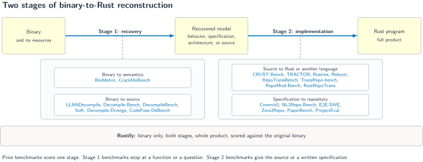
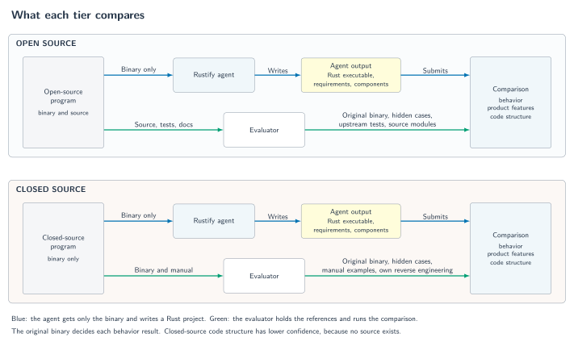

# Rustify benchmark: whole-product reconstruction from a binary in Rust

## Abstract

Rustify asks an agent to rebuild a complete program in Rust from only its binary.
No published benchmark measures this task.
Reverse engineering benchmarks stop at one function or one question.
Translation and generation benchmarks give the agent the source or a written specification.
This document defines a benchmark for the complete task.
The benchmark splits the task into two stages: recovery from the binary and implementation in Rust.
It analyzes 24 prior benchmarks against one set of dimensions and keeps the mechanisms that fit each stage.
The resulting dataset has 11 tracks in an open-source tier and a closed-source tier.
The oracle is the original binary. The score is an indistinguishability game with a ladder of graded scores.
Each tier of product size has a target score from published results.
The first agent evaluation with the graded scores has not run yet.

## 1. Motivation

Many programs exist only as binaries.
The source can be lost, closed, or written in a language that the owner wants to replace.
A user who needs an open, maintainable version of such a program has no source to translate.
Rustify addresses this need. It gives an agent the binary, and the agent writes the full product in idiomatic Rust.

A useful reconstruction keeps every user-visible behavior of the original.
It keeps the features, the outputs, the errors, the file formats, the interface, and the persistent data.
It also keeps the component boundaries, so that a maintainer can find each responsibility in the Rust code.

An evaluation for this task must answer three questions:

1. How much of the original product does the reconstruction cover?
2. On the covered features, can a user tell the reconstruction from the original?
3. Did the agent recover the product from the binary, or did it recall the source from training?

Existing benchmarks answer parts of these questions for smaller tasks.
Section 3 shows that none of them answers all three for a whole product from a binary.

### Contributions

- A two-stage task model that places each prior benchmark at the stage it measures (Section 2).
- A structured analysis of 24 benchmarks on dataset, inputs, gates, oracle, scoring, and contamination (Section 3).
- A set of requirements for this task, each tied to the prior work that motivates it (Section 4).
- A dataset of 11 tracks with hardened references and a closed-source tier (Section 5).
- An oracle and a scoring ladder that keep strict indistinguishability as the goal and still give partial credit (Section 5).
- An open implementation with a frozen-project scorer and an agent harness (Section 6).

## 2. Task definition

The SVG and PDF versions of the figure link each benchmark name to its paper.

The input is a binary and its resources, for example data files and the launch environment.
The output is a Rust project that implements the complete product.
The task has two stages:

| Stage | Input | Output | Example artifact |
| --- | --- | --- | --- |
| 1. Recovery | The binary and its resources | A recovered model of the program | Requirements, scenarios, architecture, evidence |
| 2. Implementation | The recovered model | A Rust program | A Cargo project with tests |

The recovered model is the intermediate representation.
In Rustify it is the `recovered/` folder of the target project: EARS requirements, scenarios, components, and evidence.
A prior benchmark can use a different intermediate representation, such as decompiled C or a written specification.
The stage split lets the analysis compare each benchmark with the part of the task that it measures.

The agent sees only the binary, its resources, and the skills.
It never sees the source, the upstream tests, or the documentation of a track.
It can run the binary and analyze it with reverse engineering tools.

### The goal: functional indistinguishability

A perfect reconstruction is indistinguishable from the original.
The definition follows the indistinguishability games of cryptography.

1. The challenger holds the original program `O` and the Rust program `R`.
2. The challenger picks a secret bit `b` and gives the distinguisher oracle access to `P = O` if `b = 0`, or `P = R` if `b = 1`.
3. The distinguisher `D` sends probes to `P`.
   A probe is one complete interaction: arguments, environment, standard input, files, network peers, signals, and GUI events.
4. The challenger returns the **view** of each probe: everything that a user can observe.
5. `D` outputs a guess `b'`.

The advantage of `D` is `Adv(D) = |Pr[b' = b] - 1/2| * 2`.
`R` is **(q, ε)-indistinguishable** for a class of distinguishers if no distinguisher in the class reaches an advantage above `ε` with `q` probes.
The goal is advantage `0` for every distinguisher that uses only the user-facing interface.

The view defines what "user-facing" means. Each track declares its view channels:

| Channel | Content |
| --- | --- |
| Process | Standard output, standard error, and exit status or signal. |
| Files | The files that the program creates, changes, or deletes, with their bytes and permissions. |
| Protocol | The bytes on each network connection or pipe to a peer. |
| Interface | GUI screenshots, accessibility trees, window titles, focus, and timing of visible state changes. |
| Persistence | Configuration, logs, caches, and databases that later runs read. |

A deterministic program pair is distinguishable as soon as one probe gives two different views.
That probe is a **witness**. A witness gives a distinguisher advantage `1`.
A claim holds only for the probes that the scorer ran. It never proves equivalence for all inputs.

## 3. Related work

### 3.1 Method

The analysis covers 24 benchmarks from 2024 to 2026.
It places each benchmark at the stage of Section 2 that it measures.
It then compares the benchmarks on the same dimensions:

| Dimension | Question |
| --- | --- |
| Unit | What is one task: a function, a question, a program, a repository, or a product? |
| Dataset | How many tasks, from which subjects, and with which selection filters? |
| Input | What does the system receive: a binary, decompiler output, source, tests, or a specification? |
| Gate | Which precondition sets a result to zero? |
| Oracle | Who decides correctness: tests, differential execution, a rubric, or a judge? |
| Scoring | Which metric, which partial credit, and which aggregation over tasks and trials? |
| Contamination | Which control stops the recall of public solutions? |
| Result | What are the best strict and graded results? |

Each value comes from the paper, the proceedings, or the benchmark repository.
The results come from different model generations. They show task difficulty, not a model ranking.
Each subsection ends with the fit of each benchmark: what Rustify borrows, and why the benchmark alone does not fit.

### 3.2 Stage 1: recovery benchmarks

Stage 1 benchmarks start from a binary.
Two families exist: binary to semantics, and binary to source.

| Benchmark | Unit | Dataset | Input | Gate | Oracle | Partial credit | Best result |
| --- | --- | --- | --- | --- | --- | --- | --- |
| [BinMetric](https://arxiv.org/abs/2505.07360) | Question | 1,000 questions, 6 tasks, 20 C projects | Assembly, IDA pseudo-code, or text | Parsable output; gcc build for assembly generation | Text metrics, accuracy, execution tests | Per-task text metrics | Classification accuracy 83.75 (GPT-4); decompilation CodeBLEU 25.99 |
| [CrackMeBench](https://arxiv.org/abs/2605.10597) | One check in one binary | 20 tasks: 12 generated, 8 calibration | Stripped x86-64 ELF, tools, no network, 5 minutes | Protocol, 3 submissions, timeout | Private oracle with hidden usernames | None | 11 of 12 (92%) pass@3 (GPT-5.5) |
| [LLM4Decompile](https://arxiv.org/abs/2403.05286) | Function | 164 × 4 levels; 2,621 ExeBench | objdump assembly or Ghidra output | Compile with assertions | Re-executability | Rate per optimization level | 64.18 average re-executability (Ref-22B) |
| [Decompile-Bench](https://arxiv.org/abs/2505.12668) | Function | 2M training pairs; HumanEval, MBPP, and about 60K GitHub2025 for evaluation | Function assembly | Compile and pass all unit tests | Re-executability; text and judge metrics on GitHub2025 | Rate per level | 46.79 and 55.68 average re-executability |
| [DecompileBench](https://arxiv.org/abs/2505.11340) | Function | 23,400 functions, 130 OSS-Fuzz programs, 5 levels | Shared object; LLMs get Hex-Rays output | Recompile | Branch-coverage equality in the real program; LLM judge with κ 0.778 | Rates and Elo | Coverage equivalence 0.418 (Hex-Rays); 0.346 (GPT-4o) |
| [Source recovery SoK](https://arxiv.org/abs/2610.11556) | Function | 500 functions, 45,000 samples over 9 architectures, 5 levels, stripping | Hex, assembly, p-code, or pseudo-C | Compile with the caller interface | Generated I/O tests, byte match, text metrics | 7 separate rates | Re-execution 0.59 (Agent4Decompile) |
| [Decompile-Diverge](https://arxiv.org/abs/2609.05370) | Function | 3,089 functions, including 291 GitHub and 287 CVE | Assembly or pseudo-C | Build and splice into a driver | AFL++ corpus from the reference, 4 re-runs | Rates | Matched 78% (Hex-Rays); 71% best LLM |
| [CodeFuse-DeBench](https://arxiv.org/abs/2605.29490) | Program and function | 240 functions, 8 files, 640 binaries | Executable | Staged build gates | Frida differential tracing against the original binary | Partial stdout match | Exact stdout 3.4%; exact or partial 22.3% |

Findings for Stage 1:

- The unit is one function, one question, or one check. Only [CodeFuse-DeBench](https://arxiv.org/abs/2605.29490) scores whole binaries, and its subjects are 8 synthetic files.
- The strongest oracles execute the recovered code against the original behavior: re-executability, coverage equality, and differential tracing.
- Text metrics rank methods differently from behavior metrics. The [SoK](https://arxiv.org/abs/2610.11556) reports this directly.
- Optimization roughly halves recovery. Rust and Go binaries recover much worse than C binaries.
- A fixed test suite overstates success. [Decompile-Diverge](https://arxiv.org/abs/2609.05370) finds divergence in 4.9% of candidates that pass every shipped test.
- No Stage 1 benchmark asks for the behavior, the interface, and the architecture of a whole product.

Fit for Rustify:

| Benchmark | Rustify borrows | Insufficient alone because |
| --- | --- | --- |
| [BinMetric](https://arxiv.org/abs/2505.07360) | An exact web search for distinctive recovered text, to flag leaked material on the closed tier. | Five of six tasks score text similarity on isolated snippets. No task produces a working program. |
| [CrackMeBench](https://arxiv.org/abs/2605.10597) | Seeded generated binaries for a contamination-free split; an oracle with hidden inputs outside the sandbox. | Each task recovers one small check, and the output is one answer. |
| [LLM4Decompile](https://arxiv.org/abs/2403.05286) | Re-executability; a report for each optimization level. | The unit is one C function with a small fixed assertion set. |
| [Decompile-Bench](https://arxiv.org/abs/2505.12668) | A post-cutoff split; one forced compiler setting for every project. | Only HumanEval and MBPP functions have a behavior oracle. |
| [DecompileBench](https://arxiv.org/abs/2505.11340) | Substitution into the real program with real inputs; an LLM judge only with measured human agreement. | The unit is one function. Coverage equality checks control flow, not outputs. |
| [Source recovery SoK](https://arxiv.org/abs/2610.11556) | A nested gate before any behavior score; evidence that Rust and Go binaries are harder. | The unit is one function with a given interface. |
| [Decompile-Diverge](https://arxiv.org/abs/2609.05370) | A generated corpus from the reference with a re-run filter; the gap between shipped tests and generated probes. | The unit is one C function, and the oracle sees only a bounded post-state. |
| [CodeFuse-DeBench](https://arxiv.org/abs/2605.29490) | The whole binary as the differential oracle; a separate "unsupported" outcome so that missing evidence never counts as a match. | The subjects are 8 synthetic files with stdout drivers. |

### 3.3 Stage 2: source to Rust or another language

These benchmarks give the system the source. They measure Stage 2 with a perfect intermediate representation.

| Benchmark | Unit | Dataset | Input | Gate | Oracle | Partial credit | Best strict | Best graded |
| --- | --- | --- | --- | --- | --- | --- | --- | --- |
| [CRUST-Bench](https://arxiv.org/abs/2504.15254) | C repository | 100 repositories, average 958 lines, maximum 25,436 | C source, a safe Rust interface, Rust tests | Interface, build, all tests | Hand-adapted Rust tests | Build rate apart | 48% (o3 with test repair) | Build 78% |
| [TRACTOR](https://arxiv.org/abs/2609.25121) | Test case and milestone project | 150 and 86 test cases; a project of about 100,000 lines | C source and CMake; vectors withheld | Translate, run, compare; undefined-behavior vectors skipped | Differential I/O and file state against the C binary | Failure rate per vector | 100% of B02 test cases | 96.3% of P02 vectors |
| [Rustine](https://arxiv.org/abs/2511.20617) | C program | 23 programs, 27 to 13,200 lines | C source and tests | Compile | Translated test assertions | Pooled assertion rate | 10 of 23 programs fully automated | 87% of assertions, with human repair |
| [Reboot](https://arxiv.org/abs/2606.27122) | C interpreter | 6 programs, 6,332 to 23,271 lines | C source, tests, human escalation | 100% of provided tests, no `unsafe` | Hidden validation tests | Pass rate per program | 100% of provided tests | 61.58% to 91.78% of hidden tests |
| [RepoTransBench](https://arxiv.org/abs/2412.17744) | Repository | 1,897 tasks, 13 language pairs | Source repository and internet | Compile; all tests | Generated tests that pass on the source | APR per test, AMPR per module | 32.8% | 45.4% APR |
| [TransRepo-bench](https://arxiv.org/abs/2501.16050) | Repository | 13 tasks, Java to C# | Java source and a C# skeleton | None; per-test compile | Translated tests in the skeleton | Per-test rates | None defined | 26.65% of tests |
| [RepoMod-Bench](https://arxiv.org/abs/2602.22518) | Repository | 21 repositories, 1.6M lines, 11,616 tests | Full source and build commands | Build; rule against shortcuts | Hidden black-box CLI and REST tests | Test pass rate | None reported | 48.2% of tests |
| [RustRepoTrans](https://arxiv.org/abs/2411.13990) | Function in a repository | 375 functions, 145 from C | Source function, signature, dependencies | Compile in the project | Project unit tests | None | 51.5% pass@1 | Not applicable |

Findings for this family:

- Strict whole-repository success is low even with the source: 32.8% to 48%.
- Graded scores are higher and show that most failures are partial: 26.65% to 96.3%.
- [TRACTOR](https://arxiv.org/abs/2609.25121) uses the compiled original as the oracle. It is the closest oracle to Rustify, but its vectors are fixed.
- [RepoMod-Bench](https://arxiv.org/abs/2602.22518) tests at the command-line boundary, so its tests work for any implementation language.
- Pooled rates let large programs dominate. [Rustine](https://arxiv.org/abs/2511.20617) pools assertions over all programs.
- A self-verified result overstates quality. [Reboot](https://arxiv.org/abs/2606.27122) passes 100% of its provided tests and 61.58% to 91.78% of its hidden tests.
- No benchmark in this family has a recovery stage. The source is always given.

Fit for Rustify:

| Benchmark | Rustify borrows | Insufficient alone because |
| --- | --- | --- |
| [CRUST-Bench](https://arxiv.org/abs/2504.15254) | Build success reported apart from test success; a compiler-error taxonomy for gate failures. | The system gets the source, a Rust interface, and the tests. |
| [TRACTOR](https://arxiv.org/abs/2609.25121) | The compiled original as the oracle; the vector schema; one failure fails its test case; a public and a hidden split. | The system gets the source, and the vectors are fixed. |
| [Rustine](https://arxiv.org/abs/2511.20617) | Case-level counting; a separate report of human repair. | The system gets the source and tests, and pooling lets two programs decide the score. |
| [Reboot](https://arxiv.org/abs/2606.27122) | Hidden validation tests written before the output exists; the self-check gap; feature milestones. | The system gets the source and tests, and a human stays in the loop. |
| [RepoTransBench](https://arxiv.org/abs/2412.17744) | The ladder from strict to compile to per test to per module. A module counts only when all its tests pass, as a feature does in the FPS. | The system gets the source, and an LLM generates the tests. |
| [TransRepo-bench](https://arxiv.org/abs/2501.16050) | Per-test isolation, so that one defect does not hide all other progress. | The system gets the source and a fixed target skeleton. |
| [RepoMod-Bench](https://arxiv.org/abs/2602.22518) | One black-box suite at the command-line boundary, checked at 100% on the original first. | The system gets the full source. One trial and a flat rate give no feature result. |
| [RustRepoTrans](https://arxiv.org/abs/2411.13990) | A compile-error histogram by `rustc` error code. | The unit is one function with its source and dependencies. |

### 3.4 Stage 2: specification to repository

These benchmarks give a natural-language specification. A human did Stage 1, often from the source.

| Benchmark | Unit | Dataset | Input | Gate | Oracle | Partial credit | Best strict | Best graded |
| --- | --- | --- | --- | --- | --- | --- | --- | --- |
| [Commit0](https://arxiv.org/abs/2412.01769) | Library | 54 libraries (16 lite) | Specification, stubs, unit tests | Clean-clone test run | Upstream unit tests | Unit test pass rate | 0 libraries in the paper | 42.95% lite, 15.25% all |
| [NL2Repo-Bench](https://arxiv.org/abs/2512.12730) | Repository | 104 tasks in 3 sizes | Specification and an empty workspace | None stated | Hidden upstream tests | Mean test pass rate | 5 of 104 | 40.2% |
| [E2E-SWE](https://arxiv.org/abs/2609.38335) | Repository | 186 tasks, 11 languages | Specification and an empty workspace | Fresh container, no network, 4 hours | Hidden tests; 3.9% of attempts flagged as task defects | None | 67.7% pass@1 | Not applicable |
| [Zero2Repo](https://arxiv.org/abs/2609.38269) | Repository | 17 tasks | Requirements and an interface contract | Upstream-import scan, 7,200 seconds | Hidden suite; the reference passes and adversarial variants fail | None | 15 of 17 (88.2%) | 95 of 121 failures pass 90% or more |
| [PaperBench](https://arxiv.org/abs/2504.01848) | Paper replication | 20 papers, 8,316 rubric leaves | Paper and internet with a blacklist | Fresh-VM reproduction; a blacklist violation scores 0 | LLM judge (F1 0.83) on a rubric tree | Weighted tree, binary leaves | Not applicable | 21.0% (26.0% with an iterative agent) |
| [ProjectEval](https://arxiv.org/abs/2503.07010) | Project | 20 tasks, 284 tests | Prompt, checklist, or skeleton | Valid output | Simulated user through Selenium and subprocess | Share of passed tests | Not applicable | 12.49 pass@5 |

Findings for this family:

- Strict success depends on size. Small repositories reach 67.7% to 88.2%. Large libraries reach 0 to 5 of 104.
- Test visibility changes the score. [NL2Repo-Bench](https://arxiv.org/abs/2512.12730) rises from 40.2% to 59.4% when the agent sees all tests.
- Strict failures are often near misses. In [Zero2Repo](https://arxiv.org/abs/2609.38269), 95 of 121 failed runs pass at least 90% of the hidden tests.
- [PaperBench](https://arxiv.org/abs/2504.01848) shows a weighted requirement tree with binary leaves, and it zeroes a run that breaks a rule.
- [Zero2Repo](https://arxiv.org/abs/2609.38269) validates its oracle: the reference must pass, and hollow or shortcut variants must score zero.
- The specification already contains the recovered model. No benchmark in this family measures recovery from a binary.

Fit for Rustify:

| Benchmark | Rustify borrows | Insufficient alone because |
| --- | --- | --- |
| [Commit0](https://arxiv.org/abs/2412.01769) | An n-gram overlap check after the freeze; the oracle run on the original implementation. | The agent sees the unit tests and the interface during development. |
| [NL2Repo-Bench](https://arxiv.org/abs/2512.12730) | The visible-test ablation; size tiers; all cases run even when some fail to start. | A human wrote the specification from the source. |
| [E2E-SWE](https://arxiv.org/abs/2609.38335) | A task audit that reports the share of outcomes from task defects; a 12-gram containment check. | The input is a written specification, and no partial credit exists. |
| [Zero2Repo](https://arxiv.org/abs/2609.38269) | Oracle validation: the reference passes and adversarial variants score zero; a scan that rejects the upstream code. | The input is a requirements document and an interface contract. |
| [PaperBench](https://arxiv.org/abs/2504.01848) | A weighted requirement tree with binary leaves; a rule violation that zeroes the run; re-execution in a fresh machine. | The oracle is an LLM judge, not differential execution. |
| [ProjectEval](https://arxiv.org/abs/2503.07010) | A simulated user for GUI and console views. | A single canonical solution and 284 generated tests define the oracle. |

### 3.5 Agent scoring practice

| Benchmark | Unit | Partial credit | Trials and variance | Best strict | Best graded |
| --- | --- | --- | --- | --- | --- |
| [Cybench](https://arxiv.org/abs/2408.08926) | Capture-the-flag task, 40 tasks | Subtask fraction | Single attempt and best of 3 | 17.5% unguided (20.0% best of 3) | 46.8% of subtasks (51.1% best of 3) |
| [MLE-bench](https://arxiv.org/abs/2410.07095) | Kaggle competition, 75 tasks | Medal tiers | 3 or more seeds, mean ± standard error | 16.9% ± 1.1 with any medal | 29.4% ± 1.3 above the median |

Both benchmarks report a strict result and a graded result side by side.
[MLE-bench](https://arxiv.org/abs/2410.07095) sets thresholds from a comparison population and reports the standard error over seeds.

Fit for Rustify:

| Benchmark | Rustify borrows | Insufficient alone because |
| --- | --- | --- |
| [Cybench](https://arxiv.org/abs/2408.08926) | Sequential subtasks for partial credit beside the binary result. | The answer is one string, not a program. |
| [MLE-bench](https://arxiv.org/abs/2410.07095) | Thresholds from a comparison population; pass@k with the standard error over seeds. | The score is a rank against humans, not an equivalence claim. |

### 3.6 Summary

| Dimension | Stage 1 benchmarks | Stage 2 from source | Stage 2 from a specification | Rustify |
| --- | --- | --- | --- | --- |
| Unit | Function, question, or check | Function to repository | Repository or project | Whole product |
| Input | Binary or decompiler output | Source, often tests and an interface | Human-written specification | Binary and resources only |
| Stages | 1 | 2 | 2 | 1 and 2 |
| Gate | Compile, protocol | Build, interface, tests | Clean run, rule violations | Build, freeze, skill copies, forbidden libraries, case map |
| Oracle | Re-execution or coverage of one function | Tests or vectors from the source | Hidden tests or a judge | Differential execution against the original binary |
| Distinguishers | Fixed tests; one generated corpus | Fixed tests or vectors | Fixed hidden tests | Replay, surface, generated, metamorphic, upstream, adaptive |
| Partial credit | Rates over functions | Per test, per module, per vector | Per test or rubric leaf | Per class, per feature, per milestone |
| Views | Return values or stdout | Process and files | Process, web pages | Process, files, protocol, interface, persistence |
| Contamination | Post-cutoff splits, web search, seeded binaries | Rarely stated | n-gram checks, import scans | Closed tier, hardened builds, private tracks |
| Strict result | 3.4% to 92% | 32.8% to 100% | 0 to 88.2% | Section 7 |

### 3.7 Gaps

No prior benchmark has these properties:

- Binary-only input with whole-product output.
- One evaluation of both stages.
- Closed-source subjects. All subjects are open-source projects, competition tasks, or synthetic programs.
- Framework closure. Only [RepoMod-Bench](https://arxiv.org/abs/2602.22518) and [Zero2Repo](https://arxiv.org/abs/2609.38269) forbid shortcuts, and both have the source.
- Interface views against an original program, such as screenshots and accessibility trees.
- An adaptive distinguisher that probes two blinded programs.
- Differential execution with generated probes at product scale.
- Hardened, optimized, stripped binaries at product scale. No benchmark reports an LTO build.
- The self-check gap as a standard measure. [Reboot](https://arxiv.org/abs/2606.27122) and [NL2Repo-Bench](https://arxiv.org/abs/2512.12730) measure it once.
- Variance over trials. Only [PaperBench](https://arxiv.org/abs/2504.01848), [MLE-bench](https://arxiv.org/abs/2410.07095), and [E2E-SWE](https://arxiv.org/abs/2609.38335) repeat runs.

These gaps define the requirements in Section 4.

## 4. Requirements

The analysis in Section 3 gives twelve requirements for this benchmark.
Each requirement names the problem that it solves and the prior work that supplies the mechanism.

| ID | Requirement | Problem it solves | Borrowed from | Rustify mechanism |
| --- | --- | --- | --- | --- |
| R1 | The unit is a whole product. | Function scores do not show whether a product works. | [TRACTOR](https://arxiv.org/abs/2609.25121) milestone projects, [Commit0](https://arxiv.org/abs/2412.01769) | Each track asks for the full product. No track excludes a feature. |
| R2 | The input is only the binary. | Source or a specification removes Stage 1. | [CrackMeBench](https://arxiv.org/abs/2605.10597) | The blind protocol forbids the source, the tests, and the documentation. |
| R3 | The oracle is the original binary. | Hand-written tests encode one reading of the product. | [TRACTOR](https://arxiv.org/abs/2609.25121), [CodeFuse-DeBench](https://arxiv.org/abs/2605.29490), [DecompileBench](https://arxiv.org/abs/2505.11340) | The scorer runs both programs on each probe and compares the views. |
| R4 | Fixed cases do not decide parity alone. | A fixed suite misses divergence. | [Decompile-Diverge](https://arxiv.org/abs/2609.05370), [DecompileBench](https://arxiv.org/abs/2505.11340) | Generated, metamorphic, and adaptive distinguishers add probes. |
| R5 | The hidden cases stay hidden until the freeze. | Visible tests overstate the result. | [SWE-bench](https://arxiv.org/abs/2310.06770), [Reboot](https://arxiv.org/abs/2606.27122), [NL2Repo-Bench](https://arxiv.org/abs/2512.12730) | The scorer hashes the project before it reveals a case. |
| R6 | The score gives partial credit without hiding a defect. | A strict score hides near misses. A pooled rate hides defects. | [RepoTransBench](https://arxiv.org/abs/2412.17744), [PaperBench](https://arxiv.org/abs/2504.01848), [Zero2Repo](https://arxiv.org/abs/2609.38269) | A score ladder from gate to strict. One witness fails its whole feature. |
| R7 | Integrity failures zero the score. | A wrapper or a changed project can fake parity. | [PaperBench](https://arxiv.org/abs/2504.01848), [Zero2Repo](https://arxiv.org/abs/2609.38269), [RepoMod-Bench](https://arxiv.org/abs/2602.22518) | The gate checks the freeze, the skill copies, and the forbidden libraries. |
| R8 | The build hides metadata. | Symbols and debug strings leak the source structure. | [Decompile-Bench](https://arxiv.org/abs/2505.12668), [BinMetric](https://arxiv.org/abs/2505.07360) | Hardened builds with `-O3`, LTO, hidden visibility, `-DNDEBUG`, and `strip`. |
| R9 | The dataset controls memorization. | Models recall famous source. | [Commit0](https://arxiv.org/abs/2412.01769), [the SWE-Bench Illusion](https://arxiv.org/abs/2506.12286), [CrackMeBench](https://arxiv.org/abs/2605.10597) | A closed-source tier, a memorization risk for each track, and private held-out tracks. |
| R10 | Stage 1 has its own score. | A good program can hide a poor recovered model, and the reverse. | [BinMetric](https://arxiv.org/abs/2505.07360), [PaperBench](https://arxiv.org/abs/2504.01848) | Product recall and architecture recall from `grading.yaml`. |
| R11 | The oracle is valid before it scores. | A broken oracle scores every candidate wrongly. | [Zero2Repo](https://arxiv.org/abs/2609.38269), [RepoMod-Bench](https://arxiv.org/abs/2602.22518), [Commit0](https://arxiv.org/abs/2412.01769) | The original passes against itself, and a wrong program must fail. |
| R12 | The result reports variance over trials. | One run hides stochastic variation. | [MLE-bench](https://arxiv.org/abs/2410.07095), [PaperBench](https://arxiv.org/abs/2504.01848) | Three trials per track, the median FPS, and its standard error. |

## 5. Benchmark construction

### 5.1 Dataset selection

The dataset covers products, not functions.
A track must meet these conditions:

- The product has a user-facing interface that a scorer can replay.
- The evaluator can pin the exact binary by hash.
- The product adds a new kind of behavior to the dataset: a format, a protocol, an interface, state, or an engine.
- The track records its memorization risk.

The dataset has two tiers. The tiers share the game, the views, and the witness reports.
They differ in the knowledge that the evaluator has.

#### Open-source tier

The evaluator has the source. The agent never sees it.
The source supplies upstream tests, feature lists, and the components for architecture grading.

| Track | Type | Source language | Reference | Memorization risk |
| --- | --- | --- | --- | --- |
| [base64](../open/base64/README.md) | Unix utility | C | GNU coreutils 9.12, Homebrew release | High |
| [b3sum](../open/b3sum/README.md) | Cryptography | Rust | b3sum 1.8.7 release, not stripped | High |
| [xh](../open/xh/README.md) | Network client | Rust | xh 0.26.3 release, stripped | Medium |
| [zenity](../open/zenity/README.md) | Desktop dialogs | Go | zenity 0.10.15 release | Medium |
| [bzip2](../open/bzip2/README.md) | Compression | C | bzip2 1.0.8, hardened build | High |
| [lua](../open/lua/README.md) | Interpreter | C | Lua 5.5.1, hardened build | Medium (5.5 is new) |
| [sqlite](../open/sqlite/README.md) | Database | C | SQLite 3.54.1 shell, hardened build | High |
| [ninja](../open/ninja/README.md) | Build tool | C++ | Ninja 1.13.2, hardened build | High |
| [doom](../open/doom/README.md) | Game | C | doomgeneric with Freedoom 0.13.0, hardened build | High |

#### Closed-source tier

The evaluator has no public source and observes only the user-facing behavior.
This tier tests the main use case: an open version of a program without public source.
Architecture grading uses the evaluator's own reverse engineering and has lower confidence.

| Track | Type | Reference | Memorization risk |
| --- | --- | --- | --- |
| [iconutil](../closed/iconutil/README.md) | File-format converter | macOS `/usr/bin/iconutil`, build `25G325` | Low |
| [textutil](../closed/textutil/README.md) | Document converter | macOS `/usr/bin/textutil`, build `25G325` | Low |

A closed-source target must meet all of these conditions:

- The evaluator can obtain a lawful copy without cost.
- The program runs on the evaluation host without an account or a network service.
- Users want an open version. A third-party clone or a popular request is the evidence.
- The license does not forbid the reconstruction for interoperability, or the law permits it.

| Candidate | Decision | Reason |
| --- | --- | --- |
| macOS `iconutil` | Selected | Small file-format converter. The Linux `icnsutils` package is a functional clone, which shows the demand. |
| macOS `textutil` | Selected | Document converter between text, HTML, RTF, and Word formats. No Linux equivalent exists. |
| macOS `sips`, `afconvert` | Next | Image and audio converters. |
| AppCleaner | Deferred | GUI freeware with an open alternative (Pearcleaner). It moves user files to the Trash, so safe replay needs a separate user account. |
| Cave Story (freeware) | Deferred | A Windows binary that needs Wine on macOS. The rights holder enforces takedowns against decompilations. |
| RAR | Excluded | The RAR license forbids reverse engineering to re-create the compression algorithm. |
| Obsidian | Deferred | A very large Electron application. Its terms need a legal review. |

The repository stores only the pin, the cases, and the scorer of a closed track.
It never stores the closed binary, its disassembly, its decompiled code, or an agent output.

**Framework closure.** A system tool is often a thin front end to closed frameworks.
`textutil`, for example, calls the AppKit text system for each conversion.
A Rust program that calls the same closed framework is a wrapper, not an open version.
The Rust program must implement each feature itself. It can use the operating system for files, processes, memory, and time.
The gate fails a candidate that links a library from the track's forbidden list.

#### Product size tiers

Each track also has a size tier. The tier sets the score target in Section 5.6.

| Size tier | Tracks |
| --- | --- |
| Small | base64, b3sum, iconutil |
| Medium | bzip2, xh, zenity, textutil, ninja |
| Large | lua, sqlite, doom |

### 5.2 Reference builds

The first four open tracks pin upstream release binaries. The upstream projects control their flags.
The other five open tracks pin a hardened build from pinned source:

- The C and C++ flags are `-O3 -flto -fvisibility=hidden -DNDEBUG`. The link flags are `-flto -Wl,-dead_strip`.
- The build runs `strip` and deletes the source tree.
- `build.yaml` records an audit: the defined symbols, the source-file strings, and the build-path leaks.
- Each hardened reference keeps one defined symbol.

Optimization inlines code and changes its structure. Stripping and hidden visibility remove the symbol names.
`-DNDEBUG` removes assertion strings that contain source paths.
Go and Rust binaries keep more metadata after `strip`. Go keeps function and type names in its runtime tables.
Rust keeps panic locations unless the build remaps or removes them.

### 5.3 Blind protocol

1. The harness creates one workspace for each trial with copies of the skills and of the binary.
2. It sends `/rustify BINARY PROJECT` and the blind rules to the agent.
   The rules forbid the original source, tests, and documentation, and the use of the original executable at run time.
3. The agent completes discovery, planning, implementation in slices, and validation with its own probes.
4. The harness freezes the project and the skill copies when the agent exits.
5. The scorer reveals the hidden cases only after the freeze.

The harness never repairs a project. The evaluator gives no target-specific hints.
A failed trial changes the shared skills, and a fresh reconstruction starts from the binary.
Guided product repairs are diagnostic work. They do not establish a skill gain.

### 5.4 Oracle and distinguishers

The scorer runs several classes of distinguishers. Stronger classes find witnesses that weaker classes miss.

| Class | Probes | Knowledge |
| --- | --- | --- |
| `D-replay` | The hidden track cases. | The evaluator's cases. |
| `D-surface` | Cases from the manual page, help text, and documented formats. | Public documentation. |
| `D-generate` | Seeded generated inputs for each input format, option, and option combination. | Input grammars. |
| `D-metamorphic` | Probe pairs related by a property, such as a round trip. | Product promises. |
| `D-adaptive` | An agent that probes two blinded programs `A` and `B` and searches for a witness. | Oracle access only. |
| `D-upstream` | The original project's own tests and vectors. | The original source (open tier only). |
| `D-coverage` | Inputs that a coverage-guided fuzzer finds on the original. | Planned. No scorer runs it yet. |

- The scorer replays each witness on both programs and keeps only confirmed witnesses.
- The original runs a repeatability comparison against itself. A failed repeatability check makes the score invalid.
- A program with variable output gets fixed inputs, such as a fixed clock or seed, or an explicit equivalence rule with evidence.
- The scorer never ignores an unexplained difference.
- Independent parsers check output files on the closed tier. The original always decides.
- A deliberately wrong program must fail the cases. Eight of the 11 scorers run such a control. base64, xh, and zenity do not run one yet.

**The adaptive distinguisher.** The harness hides the two programs behind a probe tool.
The agent sees only the labels `A` and `B`, which the harness assigns at random.
The agent gets a probe budget and writes candidate witnesses. The harness replays them on both programs.
A failed, empty, unpaired, over-budget, or path-leaking session is `invalid` and supports no zero-witness claim.

### 5.5 Gates

A gate failure sets every graded score to 0. These checks are gates:

- The project is present and has a Cargo build.
- The project and the skill copies match their freeze before and after the scoring.
- The candidate executable matches the hash in `verification/comparison.yaml`.
- The candidate is a runnable regular file that does not contain the reference path.
- The candidate links no library from the forbidden list.
- Each scored case maps to exactly one feature.

Cargo format, Clippy, and test failures are quality results, not gates.

### 5.6 Scoring

Strict indistinguishability is the goal, but a strict pass is rare on large products (Section 3).
The scorer therefore reports a ladder of scores. The strict result stays at the top.

| Level | Score | Rule |
| --- | --- | --- |
| 1 | Gate | An integrity failure sets every graded score to 0. |
| 2 | Case pass rate (CPR) | The mean pass rate over the distinguisher classes. Each class has equal weight. |
| 3 | Feature parity score (FPS) | The weighted share of measured features with no witness. |
| 4 | Milestone credit | The share of milestones whose measured features have no witness. |
| 5 | Strict | The scorer passes with zero witnesses in every class. |

Each feature in `grading.yaml` has a `milestone` and a `cases` pattern.
The pattern matches the key `REPORT/CASE` of each case.
The milestones `core`, `extended`, and `complete` have the weights 3, 2, and 1.
One witness fails its whole feature, so the FPS never averages a witness away inside a feature.
A feature without cases counts in the coverage, not in the FPS.
The equal class weights in the CPR stop many generated probes from hiding a few failed hidden cases.

The scorer and the grader also report these measures:

| Measure | Definition | Stage |
| --- | --- | --- |
| Feature coverage | Features with at least one case, divided by all features. | Benchmark |
| Product recall | Feature patterns found in the recovered requirements, divided by all feature patterns. | 1 |
| Architecture recall | Component patterns found in the recovered components, divided by all component patterns. | 1 |
| Structural fidelity | Original components with their own Rust module, divided by all original components. | 2 |
| Edge convergence | Converged original edges, divided by converged and absent edges. | 2 |
| Parity gate | The assessment, errors, and gap count from the agent's own ledger. | 1 and 2 |
| Self-check gap | The agent's own comparison pass rate minus the hidden CPR. | 2 |
| Test adequacy | The mutation score from `cargo mutants`. | 2 |
| Rust quality | Clippy pedantic warnings and `unsafe` uses. | 2 |
| Reliability | pass@k and pass^k over the trials. | Both |
| Cost | Wall time, tokens, and cost. | Both |

Pattern recall is a coarse measure. A match does not prove a correct requirement.
The evaluator audits a sample of requirements against the source to estimate precision.

**Targets.** The target and the floor apply to the median FPS of three trials.

| Size tier | FPS target | FPS floor | Evidence from Section 3 |
| --- | --- | --- | --- |
| Small | 0.95 | 0.90 | [Zero2Repo](https://arxiv.org/abs/2609.38269) solves 82% to 88% of small repositories strictly. [CrackMeBench](https://arxiv.org/abs/2605.10597) agents solve 92% of small binary tasks. |
| Medium | 0.85 | 0.75 | [Rustine](https://arxiv.org/abs/2511.20617) passes 87% of assertions with the source and human repair. [TRACTOR](https://arxiv.org/abs/2609.25121) performers pass 96.3% of the vectors of a 100,000-line project with the source. |
| Large | 0.70 | 0.55 | [Reboot](https://arxiv.org/abs/2606.27122) interpreters pass 61.58% to 91.78% of hidden tests with the source and human help. [NL2Repo-Bench](https://arxiv.org/abs/2512.12730) reaches 40.2%. |

No published benchmark measures whole products from a binary, so these targets are estimates.
The evaluator recalibrates a target after the first full agent evaluation.
A target is too low when all three trials exceed it. A target is too high when no trial reaches the floor.

### 5.7 Contamination controls

- Each track records its memorization risk.
- The closed tier has low risk, because no public source exists.
- Private held-out tracks stay outside the repository. They use small programs that are not public.
- Two automated checks remain planned: a source-free recall probe before discovery and an n-gram overlap check after the freeze.

### 5.8 Software quality

Functional equality does not excuse a resource failure.
The evaluator follows [the quality acceptance guide](../../skills/rustify-validate/references/quality.md).
It requires resource, reliability, data integrity, input safety, responsiveness, and maintainability evidence for each applicable workload.
The supervisors apply memory, process, stream, and time limits to each run.
A supervisor limit is an execution error, even when both programs reach the same limit.

## 6. Implementation

The evaluation is a self-contained folder with one command line, `eval/main.py`.
[The evaluation README](../README.md) gives the commands.

**Scorer.** Each track has a `run.py` scorer. The shared `harness.py` runs these steps:

1. It downloads, builds, or locates the reference and checks its hash.
2. It freezes the project files and the candidate executable.
3. It runs Cargo format, Clippy, test, and pedantic checks with one build job and a 2 GiB memory limit.
4. It runs the gate checks of Section 5.5.
5. It calls the track's case reports and checks the freeze again.
6. It maps each case to a feature and computes the score ladder.
7. It writes the reports to `work/evaluation/<track>/`.

**Agent harness.** `agent.py` runs the trials of Section 5.3 and grades them.
The grader checks the project freeze and the skill copies before it loads any helper from the trial.
It scores the frozen candidate with `run.py --frozen`, runs the parity gate from the trial's own skill copy, and measures recall.
`grades.yaml` gives each trial's scores and each track's median FPS, standard error, and tier result.

**Parity gate.** The skill's `parity.py` reads the ledger `recovered/model.yaml`.
It computes each requirement result from evidence and captures and runs the reflexion check of components against Rust modules.
A passing machine gate does not prove that the declared inventory covers every original feature.

**Tests.** `eval/tests/` checks the scorers, the grading files, the score ladder, the freeze, and the agent harness with a scripted agent.

## 7. Evaluation

### 7.1 Benchmark validity

A benchmark result is valid only when the reference is stable and the case map is complete.
The reference self-check runs each scorer with the reference as its own candidate.
It ran on macOS 26.7.2, build `25G325`.

| Track | Scored cases | Features with cases | Self-check result |
| --- | --- | --- | --- |
| base64 | 480 | 11 of 12 | All reports pass. |
| b3sum | 541 | 12 of 12 | All reports pass. |
| iconutil | 775 | 15 of 15 | All reports pass. |
| xh | 65 | 10 of 12 | All reports pass. |
| zenity | 5 | 3 of 14 | Not run. The track needs operator GUI captures. |
| textutil | 1,286 | 44 of 44 | All reports pass. |
| bzip2 | 1,342 | 27 of 31 | All reports pass. |
| ninja | 790 | 41 of 42 | `replay-browse` fails 5 cases, so the repeatability check fails. |
| lua | 645 | 41 of 41 | All reports pass. |
| sqlite | 22,618 | 57 of 57 | The upstream reports are `incomplete`. The replay reports pass. |
| doom | 141 | 19 of 33 | The case reports pass. Three manual frame checks have no evidence. |

All 28,688 scored case keys map to exactly one feature.
The ninja failure makes ninja scores invalid on this host. The cause is open.
The self-check ran ten scorers at the same time, and the `browse` tool depends on timing.

### 7.2 Skill results

No agent evaluation has run with the graded scores yet.
The first run of `python3 eval/main.py agent run` with three trials sets the baseline for each track.
This section will report, for each track: the gate result, the CPR, the median FPS with its standard error, the milestone credit, the strict result, product and architecture recall, the self-check gap, and the cost.

## 8. Threats to validity

- The public tracks are famous programs. A model can recall their source, so their scores can overstate blind reconstruction.
- The blind protocol relies on agent compliance. The harness does not isolate the filesystem or the network.
- The case suites measure only the features that they cover. Feature coverage shows the gap.
- The feature map follows the evaluator's reading of each case. Some cases test more than one feature.
- Pattern recall can count a vague requirement as a match.
- The tier targets come from other tasks with more input. They are estimates until the first run.
- The references need macOS, so the results apply to one platform.

## 9. Conclusion

The task of whole-product reconstruction from a binary has no prior benchmark.
The benchmark in this document combines mechanisms from reverse engineering, translation, and generation benchmarks.
It keeps the original binary as the oracle and strict indistinguishability as the goal.
It adds graded scores, so that progress on large products stays visible without hiding a defect.

## References

| Benchmark | Venue | arXiv |
| --- | --- | --- |
| [BinMetric](https://arxiv.org/abs/2505.07360) | IJCAI 2025 | `2505.07360` |
| [CrackMeBench](https://arxiv.org/abs/2605.10597) | arXiv 2026 | `2605.10597` |
| [LLM4Decompile](https://arxiv.org/abs/2403.05286) | EMNLP 2024 | `2403.05286` |
| [Decompile-Bench](https://arxiv.org/abs/2505.12668) | NeurIPS 2025 Datasets and Benchmarks | `2505.12668` |
| [DecompileBench](https://arxiv.org/abs/2505.11340) | Findings of ACL 2025 | `2505.11340` |
| [Source recovery SoK](https://arxiv.org/abs/2610.11556) | arXiv 2026 | `2610.11556` |
| [Decompile-Diverge](https://arxiv.org/abs/2609.05370) | arXiv 2026 | `2609.05370` |
| [CodeFuse-DeBench](https://arxiv.org/abs/2605.29490) | arXiv 2026 | `2605.29490` |
| [CRUST-Bench](https://arxiv.org/abs/2504.15254) | COLM 2025 | `2504.15254` |
| [TRACTOR](https://arxiv.org/abs/2609.25121) | MIT Lincoln Laboratory report, arXiv 2026 | `2609.25121` |
| [Rustine](https://arxiv.org/abs/2511.20617) | arXiv 2025 | `2511.20617` |
| [Reboot](https://arxiv.org/abs/2606.27122) | arXiv 2026 | `2606.27122` |
| [RepoTransBench](https://arxiv.org/abs/2412.17744) | IEEE Transactions on Software Engineering 2026 | `2412.17744` |
| [TransRepo-bench](https://arxiv.org/abs/2501.16050) | Findings of EMNLP 2025 | `2501.16050` |
| [RepoMod-Bench](https://arxiv.org/abs/2602.22518) | arXiv 2026 | `2602.22518` |
| [RustRepoTrans](https://arxiv.org/abs/2411.13990) | arXiv 2024 | `2411.13990` |
| [Commit0](https://arxiv.org/abs/2412.01769) | ICLR 2025 | `2412.01769` |
| [NL2Repo-Bench](https://arxiv.org/abs/2512.12730) | ICML 2026 (OpenReview only) | `2512.12730` |
| [E2E-SWE](https://arxiv.org/abs/2609.38335) | arXiv 2026 | `2609.38335` |
| [Zero2Repo](https://arxiv.org/abs/2609.38269) | arXiv 2026 | `2609.38269` |
| [PaperBench](https://arxiv.org/abs/2504.01848) | ICML 2025 | `2504.01848` |
| [ProjectEval](https://arxiv.org/abs/2503.07010) | Findings of ACL 2025 | `2503.07010` |
| [Cybench](https://arxiv.org/abs/2408.08926) | ICLR 2025 | `2408.08926` |
| [MLE-bench](https://arxiv.org/abs/2410.07095) | ICLR 2025 | `2410.07095` |
| [SWE-bench](https://arxiv.org/abs/2310.06770) | ICLR 2024 | `2310.06770` |
| [The SWE-Bench Illusion](https://arxiv.org/abs/2506.12286) | ICSE-SEIP 2026 | `2506.12286` |
| [Assemblage](https://arxiv.org/abs/2405.03991) | NeurIPS 2024 Datasets and Benchmarks | `2405.03991` |

The values in Section 3 come from the primary sources.
A human must check each table value against its source before external publication.
